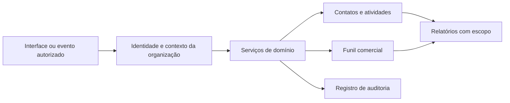

# Arquitetura de referência

Esquema conceitual de responsabilidades, não um mapa do ambiente privado.

## Decisões a avaliar

Validar o usuário sem validar a organização de cada recurso deixa uma lacuna de autorização. A mesma regra precisa alcançar busca, exportação, importação, mesclagem e tarefas em segundo plano.

A mesclagem de contatos não é apenas remoção de duplicatas: campos podem conflitar e atividades precisam continuar associadas à entidade correta. Uma política explícita de precedência e proveniência torna o resultado explicável.

## Roteiro de validação

- Tentar ler e alterar um recurso de outra organização.
- Repetir esse cenário em exportações e ações em lote.
- Mesclar contatos fictícios com campos conflitantes.
- Simular movimentações concorrentes do mesmo item de funil.
- Verificar que uma sugestão de IA não executa uma alteração sem a política prevista.
- Conferir a utilidade da auditoria sem copiar dados sensíveis para logs.

O roteiro não foi executado neste repositório. A publicação não implementa autenticação, autorização ou persistência.
