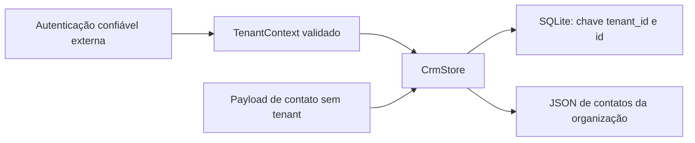

# Arquitetura da demonstração

Este documento descreve somente o código executável deste repositório, criado com dados sintéticos para mostrar escopo por organização na camada de persistência.

## Responsabilidades

| Arquivo | Responsabilidade |
| --- | --- |
| `tenant_crm/domain.py` | Contexto imutável, valores de contato, validação de entrada e erros públicos |
| `tenant_crm/store.py` | Conexão SQLite, SQL com escopo, transações e JSON estrito |
| `tenant_crm/__init__.py` | API pública pequena |
| `tenant_crm/__main__.py` | Cenários sintéticos em banco temporário |
| `tests/` | Invariantes observáveis com SQLite real e execução da demo em subprocesso |

`CrmStore` é dono de uma conexão. Use `with CrmStore(path)` ou `close()` para liberá-la. Os métodos de escrita concluem sua transação antes de retornar; não há unidade de trabalho pública que agrupe chamadas diferentes. A conexão não deve ser compartilhada entre threads.

## Fronteira de confiança

`TenantContext` recebe um identificador cuja forma é validada. A camada que autentica o usuário e verifica seu acesso à organização é externa e não foi implementada. A demo constrói dois contextos sintéticos para exercitar o contrato de armazenamento.

Todo método público que opera contatos recebe um `TenantContext` obrigatório. O contexto é verificado antes de processar o payload, inclusive em importações vazias e exportações. O banco grava `tenant_id` a partir desse contexto; o contato público contém apenas `id`, `name` e `email`.

Forjar o contexto é possível em Python e fica fora da proteção demonstrada. O mesmo vale para acessar `_connection` ou o arquivo do banco diretamente. Em produção, a camada de autenticação deve estabelecer o escopo; não basta aceitar um identificador vindo do navegador, JSON, prompt ou modelo.

## Persistência e isolamento

A tabela `contacts` tem colunas `tenant_id`, `id`, `name` e `email`, todas obrigatórias, com chave primária composta `(tenant_id, id)`. IDs podem repetir entre organizações. Um conflito nunca depende de procurar aquele ID em outra organização.

Leitura, listagem e atualização usam `WHERE tenant_id = ?`; leituras de um contato e atualizações acrescentam `AND id = ?`. Inserções incluem a organização do contexto como parâmetro. Todas as entradas de dados SQL usam placeholders `?`.

O escopo é aplicado pela aplicação. SQLite não fornece RLS neste exemplo. A criação da tabela é DDL fixa e não faz parte das consultas de contatos por organização.

`get` não distingue um ID ausente de um ID visível apenas a outra organização: ambos retornam `None`. `update` filtra por organização no próprio SQL e gera `ContactNotFound` quando nenhuma linha é afetada, sem uma consulta global para explicar a ausência. A demonstração não promete resistência a canais de tempo.

## Importação e exportação

A importação recebe uma string JSON cuja raiz é uma lista. Cada item deve conter exatamente `id`, `name` e `email`. Não há campo de tenant, upsert, mesclagem ou sobrescrita implícita. Chaves duplicadas, `NaN`/`Infinity`, documentos malformados e valores fora do contrato são rejeitados.

Todos os contatos são validados antes de executar SQL. As inserções usam `executemany` dentro de uma única transação SQLite. Um conflito de ID causa rollback do lote inteiro, inclusive dos itens anteriores; o erro público não inclui SQL nem valores do registro.

`sqlite3.connect(..., autocommit=False)` explicita o controle de transações disponível desde Python 3.12. O context manager da conexão faz commit no sucesso e rollback na exceção; o context manager de `CrmStore` fecha o recurso.

A exportação delega à listagem com escopo, ordena por ID e serializa apenas os campos do contato. Uma exportação pode ser importada em outro contexto confiável para copiar dados explicitamente; a seleção desse contexto continua sendo responsabilidade da autenticação externa.

## O que permanece fora do exemplo

Autenticação, associação usuário/organização, RLS, rotas HTTP, interface, auditoria, atividades, funil, mesclagem, IA, criptografia e controles de operação não foram implementados. Não há política de concorrência de negócio, paginação, limite de bytes/itens de importação ou migrações. Essas necessidades exigem decisões adicionais antes de usar a abordagem em uma aplicação real.
